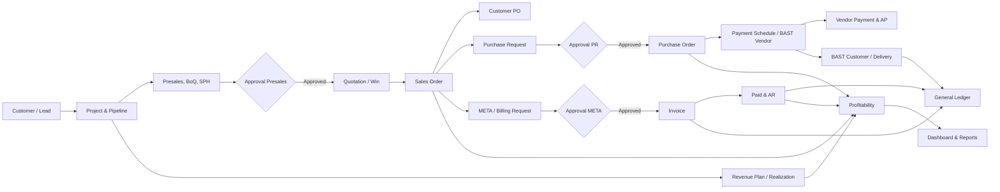
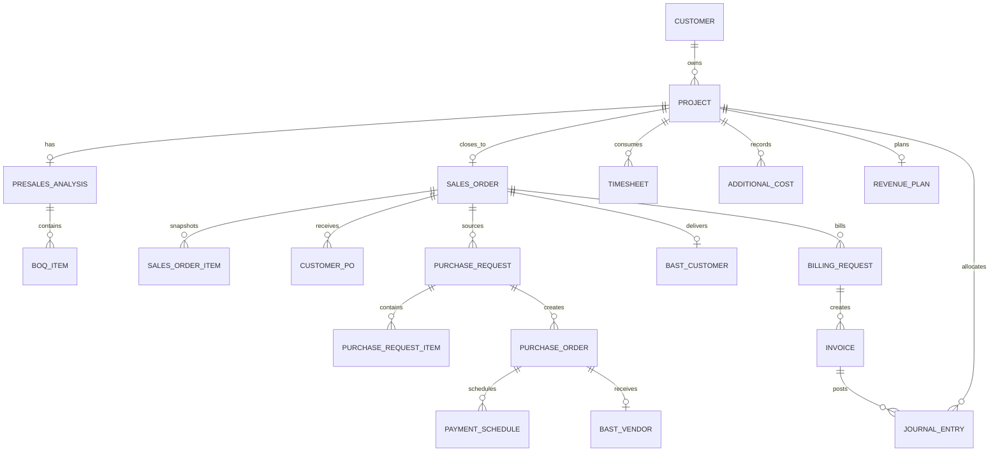

# Mini ERP Staging — Katalog Fitur dan Peta Proses End-to-End

Tanggal: 2026-10-28  
Branch: `staging`  
Audience: Business Analyst, Process Owner, Finance, Operations, Procurement,
Sales, Product & Development, System Admin, dan manajemen

## 1. Tujuan dokumen

Dokumen ini adalah katalog fitur teknis dan proses bisnis yang saat ini tersedia
di aplikasi Mini ERP staging. Dokumen ini menjadi bahan dasar BA untuk membuat
visualisasi, process map, swimlane, materi pilot, dan deck manajemen.

Dokumen ini **bukan** persetujuan go-live. Keterangan “tersedia” berarti fitur
terdapat pada UI/backend; keterangan “evidence pending” berarti fitur belum
memiliki bukti UAT formal yang cukup; keterangan “keputusan bisnis pending”
berarti implementasi teknis belum boleh dianggap sebagai kebijakan final.

## 2. Status dan legenda

| Status | Arti |
|---|---|
| Tersedia | UI dan endpoint utama sudah tersedia di staging. |
| Tersedia — evidence pending | Fitur ada, tetapi screenshot/API response, role coverage, atau UAT formal belum lengkap. |
| Tersedia — keputusan bisnis pending | Fitur teknis ada, tetapi Process Owner/Manajemen masih harus menetapkan aturan bisnis. |
| Terbatas | Fitur ada dengan batasan yang perlu diketahui BA/pilot. |
| Tidak termasuk MVP saat ini | Belum menjadi bagian dari scope staging yang dapat dijanjikan. |

## 3. Gambaran produk

Mini ERP staging menghubungkan siklus berikut:



### 3.1 Prinsip desain utama

1. Project menjadi konteks utama untuk menelusuri revenue, biaya, dokumen,
   pekerjaan, dan profitabilitas.
2. Sales Order terbentuk otomatis ketika project berhasil mencapai status
   Closing/Win; Sales Order tidak dibuat manual.
3. Item pengadaan harus ditelusuri kembali ke item Sales Order, bukan diketik
   ulang tanpa sumber.
4. Approval dibuat dari Approval Matrix dan `manager_id`; tidak ada fallback
   auto-approve saat matrix, manager, atau approver tidak tersedia.
5. Jurnal yang sudah diposting tidak diedit atau dihapus; koreksi dilakukan
   melalui jurnal penyesuaian/pembalik.
6. Backend adalah sumber kontrol akses. Penyembunyian tombol di frontend bukan
   pengganti response `403` dari backend.

## 4. Peta menu dan fitur

### 4.1 Overview dan pekerjaan pengguna

| Fitur/menu | Fungsi | Aktor utama | Status dan catatan |
|---|---|---|---|
| Login/Logout | Autentikasi user, session cookie/JWT, logout | Semua user | Tersedia; rate limit login, CSRF, dan cookie policy diterapkan. |
| Dashboard | KPI sales, target, realization, pipeline, forecast, budget, customer/project contribution | Sales, GM, Executive, Finance | Tersedia; definisi KPI dan filter perlu disepakati bisnis. |
| My Work | Work queue untuk draft, approval, tindak lanjut, dan aktivitas yang perlu dikerjakan | Semua role | Tersedia; perlu validasi prioritas dan SLA tiap unit. |
| Approvals | Daftar approval, detail step, approve/reject, komentar | Approver yang ditugaskan | Tersedia; live negative test dan evidence semua role masih pending. |
| Notifications | Notifikasi approval pending dan event terkait | Semua user | Tersedia; notifikasi bersifat best-effort, bukan invariant akuntansi. |
| Executive Dashboard | Ringkasan project, sales, revenue, margin, status, dan indikator manajemen | GM/Executive/System Admin sesuai policy | Tersedia; Executive tetap dibatasi dari business write kecuali approval yang ditugaskan. |

### 4.2 Sales, customer, dan project

| Fitur/menu | Fungsi utama | Output/data penting | Kontrol utama |
|---|---|---|---|
| Customers | Membuat, melihat, mengubah, mengarsipkan, dan restore customer | Customer master, kontak, alamat, status | Scope Sales/division; restore hanya System Admin. |
| Projects | Membuat dan mengelola project dari customer | Project code, description, customer, division, owner, type, status | Sales dapat mengelola project sesuai division; division tidak boleh dipalsukan oleh user terkunci. |
| Pipeline | Memantau stage Prospecting sampai Closing | Sales stage 1–6, pipeline status Active/Hold/Drop | Transisi dan nilai divalidasi backend. |
| SPH/Quotation | Mencatat status SPH, nomor, release date, nilai, dan hasil Win/Loss/Drop | SPH status, reason category, reason note, revenue plan | Loss/Drop wajib alasan; SPH release memerlukan stage minimal Quotation. |
| Project detail | Satu halaman konteks project untuk presales, revenue, dokumen, notes, handover, monitoring, dan profitability | Traceability lintas modul | Project yang belum Win tidak memiliki profitability rollup final. |
| Project notes | Catatan kolaborasi per project | Note, author, timestamp | Auditability dan scope akses mengikuti project. |
| Revenue plan | Menetapkan target revenue dan SPH revenue per bulan | Target, SPH revenue, target realization | Bulan menjadi dasar forecast dan monitoring. |
| Revenue realization | Mengisi realisasi revenue per bulan | Target vs realization | Perubahan harus mengikuti role dan periode yang disepakati. |
| Post-PO monitoring | Monitoring status project setelah PO | Milestone/status post-PO dan tanggal | Status operasional perlu dikonfirmasi Process Owner. |
| Project documents | Upload, list, download, delete dokumen project | RFQ, TOR, Lainnya, PO, kontrak, BAST, file path, metadata | File fisik berada di upload volume terpisah dari database; backup harus berpasangan. |
| Document expiry | Daftar dokumen yang mendekati atau melewati expiry date | Expiry date dan reminder | Kategori dan SLA reminder perlu ditetapkan bisnis. |
| Project archive/restore | Archive project/customer tanpa hard delete operasional | archived_at, archived_by | Restore project/customer dibatasi System Admin. |

### 4.3 Presales, Product & Development, dan BoQ

Presales Analysis terdiri dari empat bagian yang memiliki owner departemen:

| Bagian | Isi | Owner | Status/gate |
|---|---|---|---|
| ProDev | Solution summary dan BoQ | Product & Development | Submit ke approval manager requester; approval ProDev menjadi bagian dari gate. |
| Operations | Estimasi installation cost dan dokumen pendukung | Operations | Submit setelah isi siap. |
| Procurement | Estimasi vendor cost dan dokumen pendukung | Procurement | Submit sesuai scope Procurement. |
| Finance | Recommended price, P&L/business plan, dan dokumen Finance | Finance | Submit untuk finalisasi harga sesuai matrix. |

Fitur yang tersedia:

- status bagian: pending, pending approval, submitted;
- aging tiap bagian sejak project dibuat atau sejak submission;
- upload/download/delete dokumen presales per bagian;
- item BoQ: item name, unit, quantity, estimated vendor cost, installation
  cost, proposed sell price, dan optional item catalog;
- histori item BoQ melalui `boq_item_history` ketika item diedit;
- assignment project ProDev ke sub-tim;
- stage gate: project tidak boleh masuk Quotation dari stage di bawahnya jika
  presales belum approved.

Catatan penting untuk pilot: histori BoQ tersedia secara teknis, tetapi project
`622` belum memiliki edit sah yang menghasilkan baris histori pada evidence
terakhir. Satu edit terisolasi harus diuji sebelum S5 dinyatakan penuh.

### 4.4 Sales Order dan Customer PO

| Fitur | Proses | Kontrol |
|---|---|---|
| Sales Order otomatis | Saat project mencapai Closing/Win, sistem membuat satu SO secara idempotent. | Satu project memiliki satu Sales Order; tidak ada create manual. |
| SO item snapshot | Item SO mengambil snapshot item BoQ saat closing. | Perubahan BoQ setelah closing tidak mengubah SO secara diam-diam. |
| Customer PO | Sales dapat membuat lebih dari satu PO customer untuk satu SO, misalnya material dan jasa/instalasi. | Total, nomor, tanggal, dan relasi ke SO divalidasi. |
| SO metadata | Update metadata dan pembatalan mengikuti permission `sales_orders.manage`. | Bukan mekanisme untuk membuat SO baru. |

### 4.5 Operations dan pengadaan

#### Purchase Request

Operations membuat PR berdasarkan item Sales Order. Item PR wajib merujuk ke
`sales_order_items`, sehingga kebutuhan yang dibeli tetap dapat ditelusuri ke
SO/BoQ.

Alur:

```text
Sales Order item
      ↓
Purchase Request draft
      ↓ submit
Approval Manager → GM sesuai matrix
      ↓ approved
Procurement membuat Purchase Order
```

Fitur PR:

- daftar dan detail PR;
- item, quantity, estimated unit cost, total estimated value;
- submit untuk approval;
- status draft, pending approval, approved, rejected;
- notes dan relasi ke project melalui Sales Order.

#### Vendor dan Purchase Order

- Vendor master: create, list, detail, update, soft-delete/inactive.
- PO dibuat dari PR yang approved.
- PO berisi vendor, item PR, unit cost, total value, notes, status, dan approval.
- Status PO: draft, pending approval, approved, rejected, cancelled.
- PO dapat memiliki beberapa payment schedule dengan sequence, trigger,
  percentage, amount, due date, dan status.
- Bukti pembayaran termin dapat di-upload dan di-download.
- AP Aging menampilkan payment schedule lintas PO dan status overdue/due/paid
  sesuai perhitungan.

#### BAST Vendor dan BAST Customer

- BAST Vendor mencatat penerimaan barang/jasa dari vendor terhadap PO.
- BAST Customer mencatat serah terima pekerjaan/barang kepada customer terhadap
  Sales Order.
- Keduanya dapat memiliki item, quantity, tanggal, status, dan dokumen.
- BAST Vendor dan BAST Customer sengaja independen; tidak semua pekerjaan
  membutuhkan pengadaan vendor.
- BAST Vendor dapat memicu jurnal biaya/utang berdasarkan item yang diterima.

### 4.6 META, Invoice, AR, dan penerimaan

META adalah Memo Tagih/billing request dari Operations kepada Finance.

```text
Sales Order / delivery context
      ↓
META draft
      ↓ submit
Approval META sesuai matrix
      ↓ approved
Finance membuat Invoice
      ↓ sent
AR / payment monitoring
      ↓ paid
Jurnal invoice paid dan update laporan
```

Fitur:

- META list/detail/create/submit;
- relasi META ke Sales Order dan nilai tagih;
- approval request dan approval steps;
- Invoice dibuat dari META yang approved;
- Invoice status: draft, sent, paid, cancelled;
- issue date, due date, amount, tax amount, sent_at, paid_at;
- AR/AP Aging summary;
- status overdue dihitung saat query dari invoice sent yang melewati due date,
  bukan status permanen yang harus diubah cron.

Catatan: definisi Finance mengenai sumber invoice, dokumen wajib sebelum tagih,
termin customer, pajak, dan rekonsiliasi laporan masih membutuhkan sign-off
Finance/Manajemen.

### 4.7 Finance dan accounting

#### Chart of Accounts

Finance dapat mengelola hierarki akun dengan tipe:

- Asset;
- Liability;
- Equity;
- Revenue;
- COGS;
- Expense.

Akun dinonaktifkan melalui status inactive, bukan dihapus secara fisik jika
sudah direferensikan jurnal. Normal balance diturunkan dari account type.

#### General Ledger dan jurnal

- Jurnal manual dapat dibuat dengan beberapa line debit/kredit.
- Setiap line harus debit atau kredit positif, tidak keduanya.
- Jurnal yang sudah diposting immutable; koreksi menggunakan jurnal baru.
- Setiap jurnal dapat dikaitkan ke project untuk profitability.
- `source_type` dan `source_id` menyimpan sumber otomatis/manual.
- Posting otomatis bersifat idempotent per event.

Event yang memiliki auto-posting:

| Event | Debit | Kredit |
|---|---|---|
| BAST Vendor | COGS | Utang Usaha |
| Payment vendor | Utang Usaha | Kas/Bank |
| Invoice sent | Piutang Usaha | Revenue dan Pajak jika ada |
| Invoice paid | Kas/Bank | Piutang Usaha |

Kode COA default yang digunakan posting otomatis saat ini berasal dari baseline
seed, tetapi Finance tetap harus memvalidasi mapping akun sebelum pilot/go-live.

#### Laporan keuangan

| Laporan | Fungsi | Status |
|---|---|---|
| Neraca | Posisi asset, liability, equity | Tersedia; definisi dan rekonsiliasi Finance perlu sign-off. |
| Laba Rugi | Revenue, COGS, gross profit, expense, net income | Tersedia; evidence formal belum lengkap. |
| Arus Kas | Pergerakan kas berdasarkan jurnal/akun | Tersedia; klasifikasi bisnis perlu dikonfirmasi. |
| AR/AP Aging | Piutang customer dan kewajiban vendor berdasarkan status/jatuh tempo | Tersedia; perlu validasi sumber dan aging bucket. |
| Kas & Bank | Ringkasan saldo rekening berbasis hierarki COA | Tersedia; mapping rekening perlu disahkan Finance. |
| Journal Entries | Daftar dan detail jurnal | Tersedia; jurnal posted tidak diedit. |
| Budget | Budget, realisasi, dan trend | Tersedia; owner budget dan approval perubahan perlu ditetapkan. |

#### Profitability project

Profitability hanya menampilkan project yang sudah memiliki Sales Order/Win.
Komponen rollup:

- target revenue;
- committed cost dari PO approved;
- actual paid dari payment schedule vendor paid;
- revenue realization dari revenue plan;
- billed revenue dari invoice sent/paid;
- additional costs;
- labor cost dari timesheet × hourly rate;
- real margin dan billed margin.

Additional Costs saat ini adalah CRUD operasional tanpa Approval Engine. Jika
biaya/change-order wajib mendapat approval bisnis, rule tersebut belum boleh
dianggap tersedia dan harus menjadi keputusan/requirement tambahan.

Rumus teknis saat ini:

```text
Real Margin   = Revenue Realized - Actual Paid - Additional Costs - Labor Cost
Billed Margin = Billed Revenue - Actual Paid - Additional Costs - Labor Cost
```

Rumus dan istilah committed/actual/accrued/paid/billed masih harus disahkan
Finance sebelum angka dipakai sebagai laporan manajemen.

### 4.8 Timesheet dan labor costing

- User mencatat timesheet per project, tanggal kerja, jam, dan deskripsi.
- Jam harus lebih dari 0 dan maksimal 24 jam per hari.
- Finance/role yang ditentukan dapat mengelola hourly rate user.
- Labor cost project dihitung dari jam dikalikan hourly rate.
- Timesheet menjadi input profitability, bukan jurnal otomatis tersendiri.
- Kebijakan approval timesheet, cut-off, dan siapa yang boleh mengubah rate
  masih perlu ditetapkan Process Owner/HR/Finance.

### 4.9 Non-project work

Menu POC & Demo dan Internal Dev Request menggunakan model Work Request.

| Jenis | Konteks wajib | Contoh |
|---|---|---|
| POC | Customer wajib | Proof of Concept untuk customer. |
| Demo | Customer wajib | Permintaan demo/solusi. |
| Internal | Department requester wajib | Pekerjaan internal antar unit. |

Fitur bersama:

- create/list/update/delete request;
- status open, in progress, done, cancelled;
- target date dan notes;
- update/progress note dengan author dan timestamp;
- task list dengan done/completed_at;
- attachment upload/download/delete;
- scope akses sesuai requester, department, owner, dan role.

### 4.10 Master data dan administrasi

| Modul | Fitur |
|---|---|
| Item Catalog | Katalog item/jasa, code otomatis, unit, category, default vendor/install/sell price, active/inactive. Pemakaian di BoQ bersifat optional. |
| Users | Create/list/update/delete user, role, department/org unit, manager, read-only, email, hourly rate. |
| Org Structure | Department, org unit, roles, permission reference, manager hierarchy. |
| Approval Matrix | Create/list/update/delete rule entity type, department, min/max amount, step order, approver type, approver role. System Admin only. |
| Audit Logs | Query audit event berdasarkan entity type dan konteks user/project. |
| Document Expiry | Reminder dokumen berdasarkan expiry date. |
| Leadgen | Raw leads, agents, outreach, dan statistik sebagai fitur Sales/Leadgen yang berdampingan dengan core Mini ERP. Scope dan integrasi perlu dipisahkan saat BA membuat visualisasi. |

## 5. Kontrol akses dan role

### 5.1 Level role

| Level | Scope umum | Kemampuan utama |
|---|---|---|
| Staff | Org unit/sub-team | Membuat dan mengerjakan transaksi sesuai departemen/scope. |
| Manager | Org unit/sub-team | Review, submit/approve sesuai assignment dan matrix. |
| GM | Department | Review/approval tingkat departemen sesuai matrix. |
| Executive | Lintas departemen | Dashboard, laporan, dan approval yang ditugaskan; tidak otomatis memiliki business write. |
| System Admin | Lintas sistem | User, role, permission, matrix, audit, dan support; tidak menggantikan approval bisnis. |
| Read-only overlay | Flag pada user | GET/read sesuai scope; semua POST/PUT/DELETE ditolak backend dengan `403`. |

### 5.2 Department ownership

| Departemen | Modul/write utama |
|---|---|
| Sales | Customer, project core, pipeline, Sales Order metadata/Customer PO sesuai permission. |
| Product & Development | Solution analysis, BoQ, ProDev documents, assignment. |
| Operations | META, Purchase Request, BAST, operational handover. |
| Procurement | Vendor, Purchase Order, payment schedule, procurement documents. |
| Finance | Finance presales section, Invoice, COA, GL, reports, cost, profitability, hourly rate sesuai policy. |
| HR GA & Legal | Document expiry, timesheet/hourly rate sesuai assignment. |
| Executive | Read/dashboard dan approval yang secara eksplisit ditugaskan. |
| System Admin/IT | System configuration, user/role, audit, support. |

Catatan: department dan project division adalah dua konsep berbeda. Division
menunjukkan lini bisnis/vertikal project; department menunjukkan fungsi
organisasi. BA perlu menggambar keduanya sebagai dimensi terpisah.

## 6. Approval engine

### 6.1 Objek approval

```text
Approval Matrix Rule
  entity_type + department + amount range + step order + approver rule
                         ↓ submit
Approval Request
  entity, amount, requester, status
                         ↓ generate
Approval Steps
  approver role/user, order, status, actor, time, comment
```

### 6.2 Aturan kontrol

- Tidak ada matrix yang cocok → submission `422`, tidak membuat request/step.
- Requester tidak memiliki manager → submission `422`.
- Role approver tidak memiliki user aktif non-read-only → `422`.
- Requester tidak boleh approve request sendiri.
- Step approval harus berurutan.
- Reject wajib memiliki alasan.
- Approval decision menyimpan actor, waktu, status, dan komentar.
- Approval request dan steps dibuat dalam transaksi setelah seluruh policy check
  berhasil.
- Executive hanya boleh memutuskan approval yang memang ditugaskan.

### 6.3 Keputusan bisnis pending

- Batas nominal tiap entity type.
- Apakah semua manager saat ini memang melapor ke/di-approve oleh Executive.
- Rute approval harga.
- Process Owner tiap tahap.
- Delegation, escalation, SLA, dan pengganti approver.

## 7. Siklus status utama

### 7.1 Project dan sales

```text
Prospecting → Qualification → Presales Analysis → Quotation → Negotiation → Closing
                                                                              ↓
                                                                         Win/Loss/Drop
```

Pipeline status berjalan sebagai Active/Hold/Drop dan berbeda dari sales stage.
SPH status dapat Open, Hold, Win, Loss, atau Drop. Loss/Drop memerlukan reason
category dan, untuk Other, catatan alasan.

### 7.2 Status transaksi

| Objek | Status utama |
|---|---|
| Presales section | pending → pending approval/submitted |
| Presales overall | draft → in progress → pending approval → approved/rejected |
| Approval request | pending → approved/rejected/cancelled |
| Purchase Request | draft → pending approval → approved/rejected |
| Purchase Order | draft → pending approval → approved/rejected/cancelled |
| Billing/META | draft → pending approval → approved/rejected |
| Invoice | draft → sent → paid/cancelled |
| BAST | draft/in progress/complete sesuai alur operasional |
| Work Request | open → in progress → done/cancelled |
| Budget | draft/active sesuai pengelolaan budget dan realisasi |

Status tidak boleh diubah langsung sebagai prosedur operasional; perubahan harus
melalui route dan role yang sesuai.

## 8. Relasi data dan traceability



Relasi yang wajib terlihat dalam visualisasi BA:

- Customer → Project;
- Project → Presales/BoQ → Sales Order;
- Sales Order → Customer PO;
- Sales Order item → Purchase Request item → Purchase Order item;
- Purchase Order → BAST Vendor → vendor cost/jurnal;
- Sales Order → BAST Customer;
- Sales Order → META → Invoice → AR/jurnal;
- Project → revenue plan, timesheet, additional cost, dan profitability.

## 9. Dokumen dan storage

Jenis dokumen utama:

- project documents: RFQ, TOR, PO, kontrak, BAST, dan kategori lain;
- presales documents per section: ProDev, Operations, Procurement, Finance;
- payment proof per payment schedule;
- work request attachments.

Metadata file disimpan di database, sedangkan file fisik disimpan di Docker
named volume yang dimount ke backend. Karena itu:

1. backup database dan upload adalah dua artefak yang harus cocok;
2. restore database tanpa restore volume tidak cukup;
3. metadata tanpa file harus dianggap issue rekonsiliasi;
4. file upload tidak boleh masuk Git atau image Docker;
5. production wajib direkonsiliasi sebelum perubahan storage/upload di-merge.

## 10. Audit, keamanan, dan integritas

- Protected API memerlukan autentikasi.
- CSRF protection berlaku untuk mutation request.
- Login memiliki rate limiting.
- Read-only diblokir global di backend untuk POST/PUT/DELETE.
- Executive write guard memblokir business mutation kecuali approval decision
  yang ditugaskan.
- Permission mengontrol users, roles, approval matrix, audit, vendor, dan
  Sales Order metadata.
- Department gate membatasi modul presales, PR, PO, BAST, Invoice, COA, dan GL.
- Audit log mencatat perubahan user, role, approval, transaksi, status, dan
  dokumen sesuai event yang tersedia.
- Transaction integrity checks memeriksa relasi dan konsistensi transaksi.
- Jurnal otomatis fail-loud jika COA wajib tidak tersedia/nonaktif.
- Auto-posting menggunakan idempotency berdasarkan event source.

## 11. Dashboard dan laporan

### 11.1 Dashboard operasional

BA dapat memvisualisasikan:

- total sales, target, realization, carry-over, project-based, recurring, new
  recurring, dan opportunity;
- pipeline count dan weighted revenue;
- breakdown division, project type, customer contribution, dan status;
- forecast bulanan target vs realization;
- top projects;
- tabel customer dan project;
- budget vs realization.

### 11.2 Dashboard Executive

Fokus pada ringkasan lintas department dan lintas project untuk pengambilan
keputusan. Dashboard bukan berarti Executive dapat mengubah semua data.

### 11.3 Finance reporting

Laporan Finance yang tersedia adalah Neraca, Laba Rugi, Arus Kas, AR/AP Aging,
Kas & Bank, Journal Entries, Budget, dan Project Profitability. Definisi
resmi, basis tanggal, perlakuan pajak, committed/accrued/actual/paid/billed,
dan rekonsiliasi dengan sumber eksternal masih harus disahkan Finance.

## 12. Status evidence dan gap yang harus disampaikan BA

| Area | Status saat ini |
|---|---|
| Sales → Project → SO → Customer PO | Evidence transaction ID tersedia; screenshot/API dan audit export masih perlu dikumpulkan. |
| Presales/BoQ | BoQ dan approval tersedia; satu edit sah untuk histori BoQ masih perlu diuji. |
| META → Invoice → Paid → Jurnal | Alur UAT historis tersedia; evidence laporan Finance formal belum lengkap. |
| PR → PO → BAST → Payment | Transaction ID dan jurnal tersedia; role/cross-division live evidence masih pending. |
| Approval negative control | Code/unit test fail-closed tersedia; live response `422` dan before/after query pending. |
| Read-only | Contract test tersedia; endpoint-by-endpoint live evidence pending. |
| Approval legacy `34` | Approved tanpa step; root cause waktu/commit dan disposition pending. |
| Storage project `618` | Dua metadata file tidak ditemukan pada archive; rekonsiliasi staging dan production pending. |
| Backup/restore | Teknis disposable lulus, tetapi pasangan metadata-file dan cakupan seluruh project belum lulus. |
| Reproduksibilitas | Migration/schema tersedia; akun, manager assignment, dan matrix runtime belum seluruhnya clean-room reproducible. |
| Backup offsite | Ditunda; wajib sebelum RC/go-live. |

## 13. Skenario pilot minimum

| ID | Skenario | Modul yang terlibat | Evidence |
|---|---|---|---|
| P1 | Customer → Project → pipeline | Customer, Project, Dashboard | ID, owner, division, stage, audit. |
| P2 | Presales → BoQ → approval manager | Presales, BoQ, Approval | Version/history, status section, approver, komentar. |
| P3 | Win → Sales Order → Customer PO | Project, SO, Customer PO | Relasi, snapshot item, nilai, PO customer. |
| P4 | PR → approval → PO | PR, Approval, Vendor, PO | Source item, matrix, actor, vendor, nilai. |
| P5 | PO → payment schedule → BAST Vendor | PO, Payment, BAST | Termin, bukti, quantity received, jurnal biaya. |
| P6 | BAST Customer → META → Invoice | BAST, META, Invoice | Relasi sumber, approval, invoice status, due date. |
| P7 | Invoice → paid → jurnal | Invoice, Cash/Bank, GL | Status transition, jurnal seimbang, source event. |
| P8 | Profitability dan laporan | Profitability, AR/AP, GL, dashboard | Rekonsiliasi target/committed/paid/billed/labor. |
| P9 | Role/read-only/cross-division | Semua modul terkait | GET `200`, mutation `403`, audit log. |
| P10 | Dokumen dan pemulihan | Documents, storage, backup | Upload/download/delete, checksum, restore, reconciliation. |

## 14. Rekomendasi visualisasi untuk BA

BA dapat mengubah katalog ini menjadi visual berikut:

1. **Value-stream map:** Customer sampai laporan Finance.
2. **Swimlane:** Sales, Product & Development, Operations, Procurement,
   Finance, Executive, dan System Admin.
3. **Approval matrix diagram:** entity type, amount range, step, role, dan
   manager relationship.
4. **Document traceability map:** project/SO/PR/PO/BAST/META/Invoice/journal.
5. **Status transition diagram:** status normal, reject, cancel, dan aturan
   yang menahan transisi.
6. **Role-permission heatmap:** modul × role dengan read/write/approve/403.
7. **Finance posting diagram:** event operasional ke jurnal debit/kredit.
8. **Storage recovery diagram:** database metadata ↔ upload volume ↔ backup ↔
   restore/reconciliation.
9. **Pilot gate timeline:** entry criteria, pilot execution, exit criteria, RC,
   dan go-live.
10. **Risk/decision slide:** approval route Executive, Process Owner, nominal,
    Finance definitions, production storage risk, dan offsite backup.

## 15. Referensi implementasi dan dokumen kontrol

- [STAGING_BUSINESS_PROCESS_DOCUMENTATION.md](STAGING_BUSINESS_PROCESS_DOCUMENTATION.md)
- [STAGING_BUSINESS_PROCESS_SIGNOFF.md](STAGING_BUSINESS_PROCESS_SIGNOFF.md)
- [STAGING_PILOT_PLAN.md](STAGING_PILOT_PLAN.md)
- [STAGING_BA_FOLLOWUP_2026-10-28.md](STAGING_BA_FOLLOWUP_2026-10-28.md)
- [STAGING_UAT_EVIDENCE_INDEX.md](STAGING_UAT_EVIDENCE_INDEX.md)
- [ROLE_PERMISSION_TEST_MATRIX_STAGING.md](ROLE_PERMISSION_TEST_MATRIX_STAGING.md)
- [ops/STAGING_STORAGE.md](ops/STAGING_STORAGE.md)
- [ops/UPLOAD_METADATA_RECONCILIATION.md](ops/UPLOAD_METADATA_RECONCILIATION.md)
- Backend routes: `backend/routes/routes.go`
- Database schema history: `backend/database/migrations/`

## 16. Catatan penutup

Fitur yang tercantum di sini menggambarkan kemampuan staging saat ini, bukan
jaminan bahwa seluruh fitur sudah siap digunakan sebagai proses operasional
final. Sebelum pilot atau RC, status evidence, keputusan bisnis, keamanan,
storage reconciliation, dan backup harus tetap mengikuti dokumen sign-off dan
BA follow-up terbaru.
